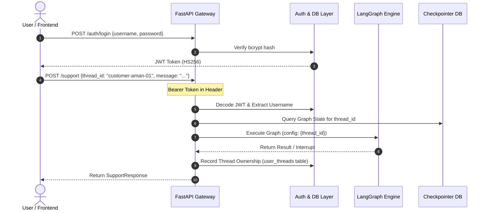

# System Architecture: Customer Support Agent with LangGraph

---

## 1. High-Level Architectural Topology

The system is architected as an enterprise-grade, stateful three-tier distributed application:

```mermaid
flowchart TD
    User([Customer / Supervisor]) <--> Frontend["Streamlit Web App<br/>(Render Free Tier)"]
    Frontend <-->|HTTPS / REST API + JWT| Backend["FastAPI Backend Service<br/>(Render Web Service)"]
    
    subgraph Backend_Core ["FastAPI Backend Internals"]
        AuthMiddleware["JWT Auth & Thread Isolation<br/>(bcrypt + python-jose)"]
        LifespanManager["Lifespan Manager<br/>Checkpointer Resource Pool"]
        GraphEngine["LangGraph Execution Engine"]
    end

    Backend --> AuthMiddleware
    AuthMiddleware --> LifespanManager
    LifespanManager --> GraphEngine

    subgraph LangGraph_Parent ["LangGraph State Machine (graph/builder.py)"]
        ReceiveQuery["receive_query"] --> ClassifyIntent["classify_intent<br/>(Deterministic Fast-Path)"]
        ClassifyIntent -->|Clear Match| RouteByIntent{"route_after_classification"}
        ClassifyIntent -->|Ambiguous| LLMClassify["llm_classify_intent<br/>(Groq Llama-3.3-70B Structured)"]
        
        LLMClassify -->|Success| RouteLLMIntent["route_llm_intent"]
        LLMClassify -->|Error| HandleError["handle_workflow_error"]
        
        RouteByIntent -->|Billing| BillingSub["billing_workflow (Subgraph)"]
        RouteByIntent -->|Technical| TechSub["technical_workflow (Subgraph)"]
        RouteByIntent -->|Account| AccountSub["account_workflow (Subgraph)"]
        RouteByIntent -->|General| GeneralSub["general_workflow (Subgraph)"]
        RouteByIntent -->|Unknown| Fallback["fallback_support"]
        
        RouteLLMIntent --> BillingSub
        RouteLLMIntent --> TechSub
        RouteLLMIntent --> AccountSub
        RouteLLMIntent --> GeneralSub
        RouteLLMIntent --> Fallback

        BillingSub -->|Escalate| HITL["human_support_workflow<br/>(interrupt)"]
        TechSub -->|Escalate| HITL
        AccountSub -->|Escalate| HITL
        HandleError --> HITL

        BillingSub -->|Resolved| Finalize["finalize_response"]
        TechSub -->|Resolved| Finalize
        AccountSub -->|Resolved| Finalize
        GeneralSub --> Finalize
        Fallback --> Finalize
        HITL -->|Command(resume)| Finalize
        
        Finalize --> EndState([END])
    end

    GraphEngine --> LangGraph_Parent

    subgraph Persistence_Layer ["Dual-Backend Persistence Engine"]
        SQLite["SQLite (Local Development)<br/>support_checkpoints.db"]
        Postgres["PostgreSQL / Neon (Production)<br/>psycopg_pool ConnectionPool"]
    end

    GraphEngine <-->|Thread Checkpoint State| Persistence_Layer
```

---

## 2. Component Responsibilities

### 2.1 Streamlit Frontend Service (`frontend/app.py`)
- **Presentation Layer**: Renders chat messages, conversation drawer, and status indicators.
- **Session State Management**: Maintains active JWT token, current `thread_id`, user identity, and real-time backend status.
- **Cold-Start Resilience**: Free-tier cloud instances sleep after 15 minutes of inactivity. The frontend features an active health probe, a 65-second keepalive wake-up trigger, and automatic UI state synchronization via `st.rerun()`.
- **Human Review UI**: When a ticket is in `human_review_required`, renders a specialized supervisor review panel to allow human operators to resolve the ticket inline.

### 2.2 FastAPI Backend Service (`api/main.py`)
- **API Gateway & Routing**: Handles REST endpoints for authentication, stateful query execution, thread history inspection, and resumption.
- **Lifespan Context Management**: Initializes the user database and checkpointer pool on startup and gracefully closes connections on shutdown.
- **Thread Security & Isolation**: Enforces user ownership of threads, preventing cross-tenant data leakage.

### 2.3 LangGraph Parent Graph Engine (`graph/builder.py`)
- Coordinates the lifecycle of every customer interaction.
- Manages routing transitions between deterministic classifiers, structured LLM fallbacks, domain subgraphs, and human escalation nodes.
- Preserves universal typed state across all transitions.

---

## 3. Typed State Schema (`graph/state.py`)

The system uses a unified state definition across the parent graph and all subgraphs:

```python
class SupportState(TypedDict, total=False):
    customer_message: str              # Raw user input for the current turn
    processed_message: str             # Normalized/cleaned user message
    
    intent: SupportIntent              # "billing" | "technical" | "account" | "general" | "unknown"
    routing_source: RoutingSource      # "deterministic" | "llm" | "unresolved"
    needs_llm_routing: bool            # Flag triggering the LLM classifier node
    
    # Billing Domain Slots
    billing_issue: BillingIssue        # "duplicate_charge" | "refund_request" | "payment_failure" | "other_billing"
    reference_id: str                  # Currently active reference ID (e.g., #REF-99214)
    return_id: str                     # Dedicated slot for return item IDs
    order_id: str                      # Dedicated slot for order refund IDs
    
    # Technical Domain Slots
    technical_issue: TechnicalIssue    # "application_error" | "performance_issue" | "feature_issue" | "other_technical"
    diagnostic_result: str             # Diagnostic log captured during analysis
    resolution_status: ResolutionStatus# "resolved" | "unresolved"
    
    # Escalation & HITL Slots
    escalation_required: bool          # Flag triggering human review routing
    escalation_reason: EscalationReason# "automatic_diagnosis_failed" | "sensitive_request" | "unsupported_request"
    
    # Account Domain Slots
    account_issue: AccountIssue        # "login_problem" | "password_reset" | "account_management" | "suspicious_access" | "account_deletion" | "other_account"
    
    # General Domain Slots
    general_issue: GeneralIssue        # "pricing_question" | "product_question" | "other_general"
    
    # Error Handling Slots
    error_occurred: bool               # Flag indicating system or LLM failure
    error_type: ErrorType              # "llm_routing_error" | "workflow_error" | "unexpected_error"
    error_message: str                 # Exact exception string for debugging
    
    # Append-Only Conversational History (LangGraph Reducer)
    messages: Annotated[list[AnyMessage], add_messages]
    
    response: str                      # Final generated response delivered to customer
```

### The `add_messages` Reducer Pattern
By default in Python `TypedDict`, updating a key overwrites its previous value. For conversational memory, overwriting message history causes catastrophic forgetting. 

By annotating `messages` with `Annotated[list[AnyMessage], add_messages]`, LangGraph applies an append-only reducer. Every new `HumanMessage` or `AIMessage` produced by a node is immutably appended to the sequence. When the graph restarts or reloads from a checkpoint, the entire conversational trajectory is reconstructed.

---

## 4. Dual-Backend Checkpointer Architecture (`config/checkpointer.py`)

Durable persistence is fundamental to stateful agentic workflows. The system abstracts the checkpointer implementation behind a configurable factory:

```python
def create_checkpointer():
    if CHECKPOINTER_BACKEND == "sqlite":
        connection = sqlite3.connect(
            DATABASE_PATH,
            check_same_thread=False,
        )
        return SqliteSaver(connection), connection

    if CHECKPOINTER_BACKEND == "postgres":
        pool = ConnectionPool(
            conninfo=DATABASE_URL,
            min_size=1,
            max_size=5,
            kwargs={
                "autocommit": True,
                "prepare_threshold": 0,
                "row_factory": dict_row,
            },
            open=True,
        )
        pool.wait()
        checkpointer = PostgresSaver(pool)
        checkpointer.setup()
        return checkpointer, pool
```

### Key Production PostgreSQL Considerations:
1. **Connection Pooling**: Uses `psycopg_pool.ConnectionPool` with a controlled pool size (`min_size=1, max_size=5`), preventing database connection exhaustion during high-concurrency bursts.
2. **Neon Serverless Compatibility**: Cloud-hosted Neon PostgreSQL operates over transaction-mode pooling (via PgBouncer). Setting `prepare_threshold: 0` disables client-side prepared statements, avoiding protocol errors on pooled connections.
3. **Automated Schema Provisioning**: Calling `checkpointer.setup()` checks and automatically provisions the checkpoint schemas, tables (`checkpoints`, `checkpoint_blobs`, `checkpoint_writes`), and indexes on initial startup.

---

## 5. Security & Multi-Tenancy Architecture



1. **Authentication**: Implemented with salted `bcrypt` password hashing (`bcrypt.hashpw`) and signed JSON Web Tokens (`python-jose`) using `HS256`.
2. **Tenant Isolation**: Conversations are identified by `thread_id`. The backend enforces that users can only query, list, or resume threads registered to their authenticated username in the `user_threads` database table.
