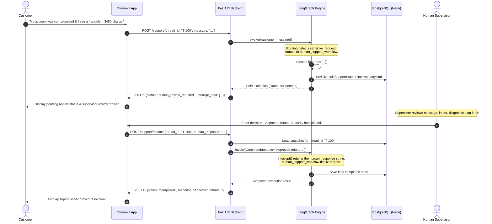

# Human-in-the-Loop (HITL) Execution Engine

---

## 1. Why Human-in-the-Loop Matters in Enterprise AI

Autonomous AI agents must have strict boundaries. Allowing an unconstrained LLM to process refunds, modify security credentials, or resolve fraud reports creates unacceptable business and legal risks.

Most chatbot implementations handle human escalation through crude handoffs: they kill the bot session, dump the user into an external ticketing queue, and lose the conversational state. The customer is forced to re-explain their problem to a live agent.

In this project, human intervention is built directly into the state machine using **LangGraph's native `interrupt()` and `Command(resume=...)` primitives**. The agent does not terminate; it **pauses execution**, serializes its complete state to PostgreSQL, waits for a human decision, and resumes execution seamlessly.

---

## 2. The HITL Execution Lifecycle



---

## 3. Node Implementation: `interrupt()` (`nodes/human_support_nodes.py`)

When the graph transitions into `human_support_workflow`, it invokes `interrupt()`:

```python
from langgraph.types import interrupt
from graph.state import SupportState


def human_support_workflow(state: SupportState) -> dict:
    human_decision = interrupt(
        {
            "type": "human_support_review",
            "customer_message": state.get("processed_message", ""),
            "intent": state.get("intent", "unknown"),
            "escalation_reason": state.get(
                "escalation_reason",
                "unsupported_request",
            ),
            "diagnostic_result": state.get("diagnostic_result"),
        }
    )

    return {
        "response": str(human_decision),
        "escalation_required": False,
    }
```

### What Happens Internally During `interrupt()`:
1. **Immediate Execution Pause**: Python execution inside the node halts at line 7.
2. **Payload Packaging**: The dictionary passed to `interrupt()` is attached to the state snapshot as an interrupt event.
3. **Database Write**: LangGraph's checkpointer writes a new row to the database (`checkpoints` and `checkpoint_blobs`) capturing the exact memory of the graph at this exact node.
4. **Control Return**: The parent `.invoke()` call exits cleanly and returns control to the FastAPI route handler.

---

## 4. API Integration: Freezing & Resuming

### 4.1 Detecting the Interrupt (`api/main.py`)
In `build_response()`, FastAPI inspects the snapshot of the thread:

```python
def build_response(graph, thread_id: str, result: dict) -> SupportResponse:
    config = {"configurable": {"thread_id": thread_id}}
    snapshot = graph.get_state(config)

    if snapshot.interrupts:
        interrupt_data = snapshot.interrupts[0].value
        return SupportResponse(
            thread_id=thread_id,
            status="human_review_required",
            interrupt_data=interrupt_data,
        )

    return SupportResponse(
        thread_id=thread_id,
        status="completed",
        response=result.get("response"),
    )
```

If a user tries to send another message while a thread is waiting for human review, the API protects graph consistency by raising an `HTTP 409 Conflict`:
```python
if snapshot.interrupts:
    raise HTTPException(
        status_code=409,
        detail="This conversation is waiting for human review. Resume the existing request before submitting another message."
    )
```

### 4.2 Resuming with `Command(resume=...)` (`/support/resume`)
When the supervisor submits their decision, FastAPI loads the thread and passes a `Command` object:

```python
@app.post("/support/resume", response_model=SupportResponse)
def resume_support_request(
    request: ResumeRequest,
    current_user: dict = Depends(get_current_user),
):
    graph = app.state.graph
    config = {"configurable": {"thread_id": request.thread_id}}

    snapshot = graph.get_state(config)
    if not snapshot.interrupts:
        raise HTTPException(
            status_code=409,
            detail="This conversation is not waiting for human review.",
        )

    # Resumes graph execution directly from the paused interrupt
    result = graph.invoke(
        Command(resume=request.human_response),
        config=config,
    )

    return build_response(graph, request.thread_id, result)
```

When `Command(resume=...)` is passed, LangGraph:
1. Finds the interrupted node (`human_support_workflow`).
2. Injects `request.human_response` directly as the return value of `interrupt()`.
3. The node assigns `response = str(human_decision)` and `escalation_required = False`.
4. Execution transitions through the normal conditional edge to `finalize_response` and finishes cleanly at `END`.

---

## 5. Fault Tolerance & Server Restarts

A critical feature of this architecture is its resilience to infrastructure restarts:

1. **Simulated Server Crash**: Suppose a ticket is interrupted waiting for review. The Render backend instance spins down or is restarted during deployment.
2. **Zero In-Memory Dependency**: All state lives in the PostgreSQL Neon database.
3. **Seamless Resumption After Reboot**: When the supervisor approves the ticket minutes or days later, the newly started FastAPI instance connects to PostgreSQL, loads the saved checkpoint via `thread_id`, and resumes execution with zero data loss.
