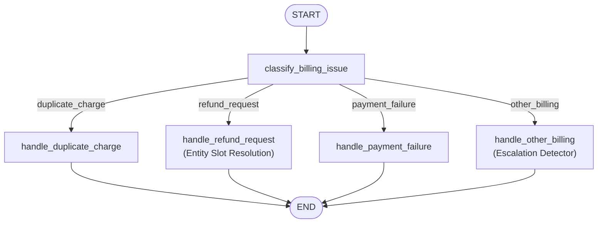
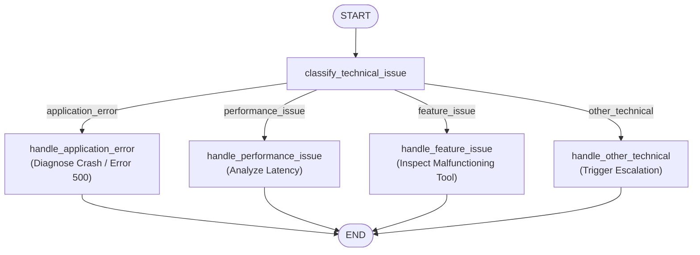
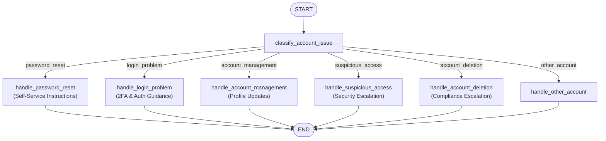

# Domain Workflows & Specialized Subgraphs

---

## 1. Overview of Domain Subgraphs

Monolithic prompts that attempt to instruct an LLM on every business rule inevitably suffer from hallucinations, rule degradation, and high token costs. The **Customer Support Agent** solves this by modularizing business domains into four dedicated **LangGraph Subgraphs**:

```
                    ┌──────────────────────────────┐
                    │      Parent Router Node      │
                    └──────────────┬───────────────┘
           ┌───────────────┬───────┴───────┬───────────────┐
           ▼               ▼               ▼               ▼
    ┌─────────────┐ ┌─────────────┐ ┌─────────────┐ ┌─────────────┐
    │   Billing   │ │  Technical  │ │   Account   │ │   General   │
    │  Subgraph   │ │  Subgraph   │ │  Subgraph   │ │  Subgraph   │
    └─────────────┘ └─────────────┘ └─────────────┘ └─────────────┘
```

Each subgraph is compiled independently as a `StateGraph(SupportState)` and attached as a composite node within the parent graph.

---

## 2. Billing Workflow (`workflows/billing/builder.py`)

The Billing subgraph manages transactions, invoices, refund eligibility, payment issues, and financial escalations.



### 2.1 Multi-Entity Extraction & Slot Resolution (`_resolve_entities`)
One of the most complex challenges in customer support is handling interleaved referential queries (e.g., discussing a return, switching to ask about pricing, and then returning to the return or an order).

In `nodes/billing_nodes.py`, the system implements a slot-based entity resolution engine:

```python
def _resolve_entities(state: SupportState) -> tuple[str | None, str | None, str | None]:
    message = state.get("processed_message", "").lower()
    raw_message = state.get("processed_message", "")

    return_id = state.get("return_id")
    order_id = state.get("order_id")
    active_ref = state.get("reference_id")

    # Step 1: Explicit entity in current message takes absolute precedence
    match = re.search(r"#?[A-Z]+-\d+", raw_message)
    if match:
        found = match.group(0)
        active_ref = found
        if "return" in message or found.startswith(("#REF", "REF")):
            return_id = found
        if "order" in message or found.startswith(("#ORD", "ORD")):
            order_id = found
    else:
        # Step 2: Referential query: recall specific entity type from state or history
        if "return" in message:
            if return_id:
                active_ref = return_id
            else:
                for msg in reversed(state.get("messages", [])):
                    c = getattr(msg, "content", "") if not isinstance(msg, dict) else msg.get("content", "")
                    if "return" in c.lower() or "#ref" in c.lower() or "ref-" in c.lower():
                        m = re.search(r"#?[A-Z]+-\d+", c)
                        if m:
                            return_id = m.group(0)
                            active_ref = return_id
                            break
        elif "order" in message:
            if order_id:
                active_ref = order_id
            else:
                for msg in reversed(state.get("messages", [])):
                    c = getattr(msg, "content", "") if not isinstance(msg, dict) else msg.get("content", "")
                    if "order" in c.lower() or "#ord" in c.lower() or "ord-" in c.lower():
                        m = re.search(r"#?[A-Z]+-\d+", c)
                        if m:
                            order_id = m.group(0)
                            active_ref = order_id
                            break

    return active_ref, return_id, order_id
```

#### How Slot Disambiguation Works in Practice:
1. **Turn 1**: *"My return is for item #REF-99214. What is its status?"*
   $\rightarrow$ `return_id` and `reference_id` are set to `#REF-99214`. Subgraph responds with return review status.
2. **Turn 2**: *"I also requested a refund for order #ORD-7842. What is its status?"*
   $\rightarrow$ `order_id` is set to `#ORD-7842`, `reference_id` updates to `#ORD-7842`. `return_id` remains preserved in state!
3. **Turn 3**: *"What was the return item number I mentioned earlier?"*
   $\rightarrow$ The resolver detects `"return"`, retrieves `#REF-99214` from `state["return_id"]`, and outputs: *"The item number for your return is #REF-99214."*
4. **Turn 4**: *"What was the refund order number?"*
   $\rightarrow$ The resolver detects `"order"`, retrieves `#ORD-7842` from `state["order_id"]`, and outputs: *"The order number for your refund is #ORD-7842."*

### 2.2 Sensitive Financial Escalation
In `handle_other_billing`, the node monitors for security-sensitive keywords:
- `"unauthorized charge"`, `"unauthorized charges"`, `"fraud"`, `"account was compromised"`, `"speak with a human"`.
- When detected, the node updates state:
  ```python
  return {
      "escalation_required": True,
      "escalation_reason": "sensitive_request",
  }
  ```
- The parent graph conditional edge immediately routes execution away from automated response generation into the `human_support_workflow` interrupt.

---

## 3. Technical Support Workflow (`workflows/technical/builder.py`)

The Technical subgraph diagnoses and assists with application bugs, latency, and platform issues.



### 3.1 Technical Subcategories
- **`application_error`**: Handles error codes (e.g. HTTP 500, 404, 503) and crash logs. Performs simulated diagnostic log inspection (`diagnostic_result = "error_code_500_detected"`), records resolution steps, and marks `resolution_status = "resolved"`.
- **`performance_issue`**: Evaluates report generation delays, dashboard timeouts, and high latency.
- **`feature_issue`**: Resolves export button glitches, report formatting errors, and broken UI interactions.
- **`other_technical`**: Catches complex issues that automated diagnostics cannot resolve. Sets `escalation_required = True` and `escalation_reason = "automatic_diagnosis_failed"`.

---

## 4. Account Administration Workflow (`workflows/account/builder.py`)

The Account subgraph manages user identities, security credentials, and access audits.



### 4.1 Security-Critical Escalations
1. **Suspicious Access (`suspicious_access`)**:
   - Triggered when users report alerts of unrecognized logins from another country or unknown devices.
   - Sets `escalation_required = True` and `escalation_reason = "sensitive_request"`.
   - Halts execution for supervisor verification before locking or modifying account credentials.
2. **Account Deletion (`account_deletion`)**:
   - Triggered by GDPR / CCPA right-to-be-forgotten requests.
   - Irreversible actions are blocked from autonomous execution and routed to human compliance teams.

---

## 5. General Inquiries Workflow (`workflows/general/builder.py`)

The General subgraph handles high-volume informational questions without requiring human escalation:
- **`pricing_question`**: Provides detailed breakdowns of pricing tiers (Free, Pro, Enterprise), monthly vs. annual billing, and seat quotas.
- **`product_question`**: Answers questions about business operating hours (e.g., Sunday customer support availability), browser compatibility, and product features.
- **`other_general`**: Serves as a friendly informational catch-all for greetings and company background.

